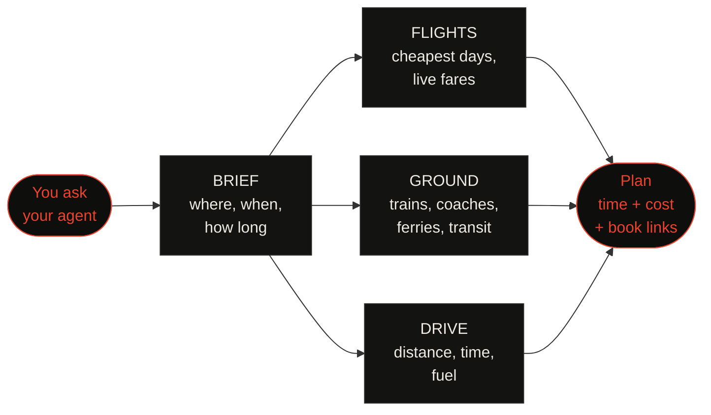

<div align="center">


# Worldwide Transit

### Flights, trains, coaches, ferries, transit and driving, priced and timed door to door. Hand it to your agent.

[](.github/workflows/selftest.yml)
[](LICENSE)
[](#installation)
[](SKILL.md)
[](#how-it-works)


</div>

## Overview

Worldwide Transit is an agent travel planner for anywhere in the world. Install it with one line, tell your agent your
city, and ask what you would ask a travel agent: the cheapest week in January to fly to Tokyo for 30 days, whether
driving to Vancouver and flying from there beats flying from home, a month-long trip across Asia priced leg by leg, or
just the next bus. Every price and time comes from live data at the moment you ask, never from memory.

## What it does

- **Flights:** live fares, the cheapest day to leave for a stay of N days, and multi-city trips priced leg by leg.
- **Ground:** trains, intercity coaches, ferries, city buses and metro, with transfers and live delays where published.
- **Driving:** distance, time and fuel cost for any road trip, so "drive part way, then fly" can be compared properly.
- **Door to door:** your agent joins the legs into one plan with total time and the total of everything it could price.
- **Honest money:** only real prices with their source. Anything it cannot price is listed as "not priced", never guessed.
- **No setup:** no API keys, no accounts, no dependencies. Works with Claude Code, Codex, Gemini CLI and any skills harness.
- **Never books:** it finds and compares; you book through the links it gives.

## How it works



| Script | Source | What it answers |
|---|---|---|
| `flights.py` | Google Flights public web data | live fares, cheapest days to fly, multi-city legs |
| `transit.py` | [Transitous](https://transitous.org) | trains, coaches, ferries, buses and metro with transfers and live delays |
| `gtfs.py` | [Mobility Database](https://mobilitydatabase.org) | exact times from 1,809 official timetable feeds when Transitous lacks a region |
| `drive.py` | [Valhalla](https://valhalla.github.io/valhalla/) and OSRM on OpenStreetMap | driving distance, time and fuel |

`SKILL.md` teaches the agent how to join them: pin down the brief, find the cheapest days, compare a nearby bigger airport
(with the drive or coach to get there), check whether a train or ferry beats a short flight, add up door-to-door time,
and check the destination's official entry rules.

## Installation

**Give this to your agent:**

```text
Install https://github.com/Bestdoom20/worldwide-transit and set it up for me.
```

It follows [AGENTS.md](AGENTS.md): installs the skill, asks what city you are in, plans one trip near you to prove it
works, and tells you what to ask. Any agent with a shell can do it.

**Or from the command line:**

```bash
curl -fsSL https://raw.githubusercontent.com/Bestdoom20/worldwide-transit/main/install.sh | sh
```

Windows PowerShell:

```powershell
irm https://raw.githubusercontent.com/Bestdoom20/worldwide-transit/main/install.ps1 | iex
```

The installer needs `git` and Python 3.9+. It puts the skill in `~/.claude/skills` (Claude Code) and
`~/.agents/skills` (Codex, Gemini CLI and others), runs the selftests and prints `INSTALL OK`. Run it again to update.
Another folder: `sh install.sh /path/to/skills`.

## Examples

All output below is real, run on 2026-11-20 and 2026-11-21, with some lines trimmed.

The cheapest week to leave for 30 days in Japan:

```
$ python3 flights.py dates YLW NRT,HND --from 2027-01-10 --to 2027-01-16 --stay 30
Cheapest round trips of 30 days YLW -> NRT,HND, leaving 2027-01-10 to 2027-01-16, prices in CAD
  Tue Jan 12 -> Thu Feb 11  CAD 1,221
  Wed Jan 13 -> Fri Feb 12  CAD 1,500
  Thu Jan 14 -> Sat Feb 13  CAD 1,510
  Sat Jan 16 -> Mon Feb 15  CAD 1,819

Best: leave Tue Jan 12, back Thu Feb 11  CAD 1,221  https://www.google.com/travel/flights?q=...
```

Live flights for that day:

```
$ python3 flights.py search YLW NRT,HND 2027-01-12 --currency CAD -n 1
CAD 648  19h10m  1 stop
    WS180    YLW Tue Jan 12 5:20 AM -> YYC Tue Jan 12 7:30 AM
    WS80     YYC Tue Jan 12 2:45 PM -> NRT Wed Jan 13 4:30 PM
```

Driving to a bigger airport instead (fuel price given by the traveller):

```
$ python3 drive.py "Kelowna" "Vancouver International Airport" --consumption 8.5 --fuel-price 1.55
Drive: 408 km, 4h44m at typical road speeds, before traffic, stops and border waits
Fuel: 34.7 L = CAD 53.76
```

A ferry, straight from the planner:

```
$ python3 transit.py plan "Tsawwassen Ferry Terminal" "Swartz Bay" --date 2026-11-24 --at 09:00 -n 1
leave Tue Nov 24 10:00 AM  arrive Tue Nov 24 11:40 AM  1h40m  0 transfer(s)
    10:00 AM  ferry BC Ferries toward Swartz Bay (Victoria)
```

Cross-border trip with a transfer:

```
$ python3 transit.py plan "Pacific Central Station, Vancouver" "King Street Station, Seattle" --date 2026-11-24 --at 08:00 -n 1
From: Vancouver (Pacific Central Station) (Metro Vancouver Regional District, British Columbia, Canada)
To:   King Street Station (King County, Washington, United States)
Times in America/Vancouver

leave Tue Nov 24 8:00 AM  arrive Tue Nov 24 12:03 PM  4h03m  0 transfer(s)
    8:00 AM  coach FlixBus-us FlixBus 2114 toward Seattle Bus Station
        Vancouver (Pacific Central Station) -> Seattle Bus Station  arrive 11:50 AM
    walk 13 min to King Street Station
```

A trip away from home (`--near` steers names, `--tz` sets the zone):

```
$ python3 transit.py plan "Shibuya" "Asakusa" --near Tokyo --tz Asia/Tokyo -n 1
leave Sat Nov 21 9:49 AM  arrive Sat Nov 21 10:23 AM  34 min  0 transfer(s)
    9:49 AM  subway 東京メトロ Tokyo Metro G toward (普通 Local) 浅草 Asakusa
        渋谷 Shibuya -> 浅草 Asakusa  arrive 10:23 AM
```

When the planner has no route, it prints the backup commands:

```
$ python3 transit.py plan "Kelowna" "Vancouver"
No public transport route found in Transitous. Next, find official feeds covering each end:
    python3 gtfs.py feeds 49.88792,-119.49590
    python3 gtfs.py feeds 49.26087,-123.11395

$ python3 gtfs.py feeds 49.88792,-119.49590
 2555  BC Transit (Kelowna Regional Transit System)  (Kelowna, British Columbia, CA)
 1871  Rider Express  (British Columbia, CA)
  735  VIA Rail Canada  (CA)

$ python3 gtfs.py next kelowna "ubco exchange" --date 2026-11-23 --at 07:00 -n 3
Feed 2555  BC Transit (Kelowna Regional Transit System)  (Kelowna, British Columbia, CA)
Monday 2026-11-23, scheduled times in America/Vancouver (feed valid 20261118 to 20261219)
               7:00 AM  route 84 Academy Way  from UBCO Exchange Bay A
               7:00 AM  route 97 Westbank  from UBCO Exchange Bay C
               7:05 AM  route 8 University - To UBCO  from UBCO Exchange Bay B

$ python3 gtfs.py next 1871 "kelowna downtown"
FEED EXPIRED: it ends 20231230, so it has no times for 2026-11-20. Use the operator's own website.
```

## Limits

- **Flight prices** come from Google Flights' public web data, which has no official API. Google throttles bursts (the
  script backs off and says "rate limit" rather than "no flights") and may change the format. Prices move by the hour:
  treat them as a strong lead and confirm on the link.
- **Ground coverage** is whatever operators publish as open data: strong across Europe, North America, Japan and
  Australia, patchy for private coaches and parts of South Asia and Africa.
- **Drive times** are at typical road speeds, before traffic, stops and border waits. Drives over 1,500 km use OSRM,
  whose times run 10 to 25 percent long, and the output says so.
- **Not priced:** hotels, parking, transit fares and visas. Your agent looks these up on the web and cites them, or lists
  them as not priced.

## How gtfs.py reads a feed

A GTFS feed is a zip of CSV files: `stops.txt`, `routes.txt`, `trips.txt`, `stop_times.txt`, `calendar.txt`, `calendar_dates.txt` and, for headway-based lines, `frequencies.txt`. The time zone comes from the feed's own `agency.txt`.

Things in the data that are easy to get wrong, each with a case in the selftest:

- **Times past 24:00.** A bus that leaves at 12:30 AM on Saturday is written as `24:30:00` on Friday's service. Asking for Saturday has to pull in Friday's late trips, and asking for Friday has to label them "next day".
- **Service days.** A weekday trip must not show up on a Saturday. The weekly calendar is applied first, then the dated additions and removals for holidays.
- **One bus, several trips.** A loop route ends its trip at an exchange and the same vehicle carries on as a new trip with riders still on board. The script follows the vehicle through its `block_id`, so the ride is found.
- **Headways.** Many metros publish "every 3 minutes from 5 AM to midnight" instead of each run. Departures are expanded from `frequencies.txt`.
- **Dead feeds.** A feed whose end date has passed stops with `FEED EXPIRED` rather than printing nothing.

## Check

```
$ for s in transit gtfs flights drive; do python3 $s.py selftest; done
selftest ok
selftest ok
selftest ok
selftest ok
```

All four run offline, and CI runs them on Python 3.9 and 3.13 on every push.

## What it will not do

- **Answer from memory.** Every time comes from a timetable read at the moment you ask.
- **Pass off a dead feed.** An expired timetable stops with `FEED EXPIRED` instead of printing old times.
- **Hammer free services.** One request per question (one per day for `dates`), cached feeds, polite back-off.
- **Guess a price.** Fuel needs a real price per litre; anything it cannot price is listed as not priced.
- **Book or pay.** It links Google Flights, the airline or the operator; booking stays with you.

## Links

- **Agent skill:** [SKILL.md](SKILL.md) · agent install steps: [AGENTS.md](AGENTS.md)
- **Data:** [Transitous](https://transitous.org) (operators' open feeds and OpenStreetMap) · [Mobility Database](https://mobilitydatabase.org) · [Valhalla](https://valhalla.github.io/valhalla/) and [OSRM](https://project-osrm.org) on OpenStreetMap
- **Credits:** flight request format from [fli](https://github.com/punitarani/fli) (MIT), see [NOTICE](NOTICE)

## How this was built

I designed it, decided what it had to get right (the cases above) and directed AI coding agents to write the code. I
tested it against real schedules and I can walk through every part.

<div align="center"><sub>MIT licensed. Timetables stay under their operators' own licences. Your home region stays in one file on your machine.</sub></div>
